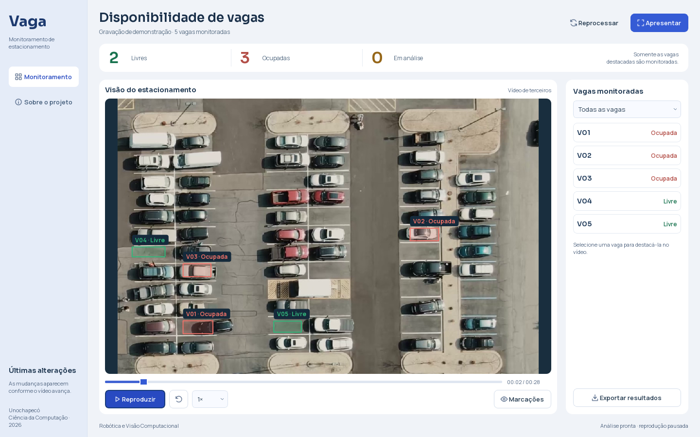

# Monitoramento inteligente de vagas de estacionamento

[](https://github.com/VitorRodi/detector-vagas-estacionamento/actions/workflows/testes.yml)

Projeto acadêmico para a disciplina de Robótica e Visão Computacional, Unochapecó, docente Wagner Titon.

Grupo: Vitor Rodi, Pedro Toigo, Bruno Fell Antunes e Edson Leandro Soares.

## Problema e proposta

O projeto investiga a dificuldade de consultar rapidamente quais vagas de um estacionamento estão disponíveis. A proposta é analisar regiões de uma câmera fixa e apresentar uma indicação visual de ocupação que possa ajudar motoristas e responsáveis pelo local. O estacionamento específico, as observações e as entrevistas ainda precisam ser registrados pelo grupo; não há medição de redução de tempo de procura.

## Situação atual

O protótipo foi verificado com dados simulados e executa uma demonstração com cinco vagas cadastradas em uma filmagem real de terceiros. A amostra visualmente rotulada do clipe permite uma conferência exploratória; não representa validação independente em outros estacionamentos. A coleta própria e a avaliação em outras gravações são acompanhadas nas [issues do projeto](https://github.com/VitorRodi/detector-vagas-estacionamento/issues). O vídeo final do grupo ainda não foi gravado ou publicado. A entrega exigida é um link do YouTube acessível e este repositório público.



A janela nativa apresenta contadores, seleção e filtros por estado, histórico de alterações, reprodução com busca e velocidade ajustável, tela cheia e exportação dos resultados. Depois da instalação, funciona localmente sem internet. A demonstração usa uma gravação incluída no projeto.

## Tecnologias e método

Python 3.10 ou mais recente, NumPy, OpenCV e PySide6 (Qt para a interface). O método utiliza tons de cinza, filtro gaussiano, diferença absoluta contra uma referência vazia, limiarização, abertura morfológica, máscaras poligonais e confirmação temporal. **Não utiliza modelo treinado, rede neural ou pesos externos.**

## O que funciona

- Cadastro manual de vagas como quadriláteros convexos.
- Comparação com uma foto fixa em que **todas as vagas cadastradas estejam vazias**.
- Classificação por fração de pixels alterados, com dois limiares e confirmação temporal.
- Entrada por imagem, vídeo ou câmera local; marcação por cores e contagem de estados.
- Interface nativa com contagem sincronizada ao quadro, filtros, seleção e histórico.
- Exportação de CSV, imagem ou vídeo anotado e pacote ZIP dos resultados.
- Demonstração simulada reproduzível e testes de comportamento.

Este programa mede alterações de aparência. Não reconhece semanticamente carros e pode confundir sombras, pessoas e objetos com ocupação. Não foi validado em estacionamento real.

## Abrir o aplicativo no Windows

Com Python 3.10 ou mais recente instalado, dê dois cliques em **[INICIAR_APLICATIVO.bat](INICIAR_APLICATIVO.bat)**. O iniciador cria o ambiente local e instala as dependências se necessário; essa primeira instalação precisa de internet. Em seguida, abre a janela e processa os 679 quadros da gravação. Aguarde a mensagem de análise pronta e clique em **Reproduzir**.

Para instalar e abrir pelo terminal:

```powershell
py -m venv .venv
.\.venv\Scripts\python.exe -m pip install -r requirements-app.txt
.\.venv\Scripts\python.exe aplicativo.py
```

Use **Apresentar** ou F11 para tela cheia; Esc sai da tela cheia; na janela normal, pausa a reprodução. O filtro mostra vagas livres, ocupadas ou em análise; clicar em uma vaga destaca sua região. O histórico permite voltar ao quadro de uma alteração. **Reprocessar** executa o detector novamente e **Exportar resultados** salva um ZIP. Os contadores sempre incluem as cinco vagas monitoradas, mesmo com um filtro aplicado.

Para abrir uma análise completa já salva, use `.\.venv\Scripts\python.exe aplicativo.py --usar-resultados`. Os controles, arquivos e solução de problemas estão em [docs/APLICATIVO.md](docs/APLICATIVO.md).

## Executar o detector pelo terminal

A interface é opcional. Para usar apenas o detector, abra o terminal **nesta pasta**, com Python 3.10 ou mais recente:

```powershell
py -m venv .venv
.\.venv\Scripts\python.exe -m pip install -r requirements.txt
.\.venv\Scripts\python.exe executar_exemplo.py --show
```

Esse comando processa o vídeo real incluído, usa a referência e as cinco regiões cadastradas, exporta os resultados e avalia a amostra de 60 rótulos visuais. A janela permite pausar com espaço e sair com Q ou Esc. Sem `--show`, a execução não abre janela. Para conhecer a seleção das vagas e as limitações dessa avaliação, leia [o experimento real](docs/EXPERIMENTO_REAL.md).

Para repetir a demonstração simulada:

```powershell
.\.venv\Scripts\python.exe demo.py
.\.venv\Scripts\python.exe detector.py --source dados/cena_simulada.png --reference dados/referencia_vazia.png --config dados/vagas_demo.json --output resultados/imagem
.\.venv\Scripts\python.exe detector.py --source dados/video_simulado.mp4 --reference dados/referencia_vazia.png --config dados/vagas_demo.json --output resultados/video
```

As saídas do exemplo real ficam em `resultados/carpark/`; as da simulação ficam em `resultados/imagem/` e `resultados/video/`. Os dados de entrada simulados estão versionados e podem ser regenerados. Em Linux e macOS, crie o ambiente com `python3 -m venv .venv` e use `.venv/bin/python` nos mesmos comandos.

Cada execução exporta `ocupacao.csv`, `eventos.csv`, `resumo.json` e `ultimo_quadro.png`, além de imagem ou vídeo anotado. O exemplo real também gera `avaliacao.json`. Os eventos incluem a confirmação do estado inicial e as mudanças posteriores. O resumo registra o tempo total de execução, que inclui exportação e eventual reprodução e pausa; com janela aberta, sua taxa não é um benchmark isolado do algoritmo. A avaliação completa é omitida se a reprodução for encerrada pelo usuário antes do fim.

## Usar imagens reais

### Vídeo externo incluído

[Abrir carPark.mp4](dados/terceiros/carPark.mp4): filmagem de estacionamento com 679 quadros, 24 FPS, resolução de 1100 × 720 e duração aproximada de 28,29 segundos. O arquivo foi obtido do projeto de [Harsh Bafna](https://github.com/harshbafnaa/car-parking-detection). Os créditos, a declaração de licença na fonte e a revisão utilizada estão em [docs/FONTES_MIDIA.md](docs/FONTES_MIDIA.md); a integridade e as características do arquivo estão em [carPark.metadata.json](dados/terceiros/carPark.metadata.json).

O arquivo é uma gravação externa. Para reproduzir o experimento, usem `executar_exemplo.py`, que utiliza `referencia_carpark.png` e `vagas_carpark.json`. Foram selecionadas cinco regiões internas que estão vazias no quadro 678; as outras vagas visíveis não são monitoradas. Não usem o JSON da simulação neste vídeo. Os parâmetros iniciais foram mantidos; a escolha das regiões e da referência foi feita no próprio clipe, o que limita a interpretação dos resultados.

### Gravação e calibração

1. Siga o [guia de gravação](docs/COLETA_REAL.md), fixe a câmera e mantenha a mesma posição, foco e resolução. Guarde os vídeos locais em `dados/reais/`, que não é publicado automaticamente.
2. Localize no vídeo um quadro com **todas as vagas que serão cadastradas vazias**. Extraia esse quadro na resolução original. Não presuma que o primeiro quadro esteja vazio:

```powershell
.\.venv\Scripts\python.exe extrair_referencia.py --video dados/reais/video_real.mp4 --quadro 0 --output dados/reais/referencia.png --confirmar-vagas-vazias
```

O exemplo usa o quadro zero. Troque o índice se necessário e confirme visualmente a ausência de veículos nas vagas a cadastrar. A opção de confirmação exige essa revisão humana; o programa não verifica automaticamente que a cena está vazia.

3. Cadastre os quatro cantos de cada vaga, em ordem ao redor do contorno:

```powershell
.\.venv\Scripts\python.exe calibrar.py --reference dados/reais/referencia.png --output dados/reais/vagas.json
```

Clique quatro vezes, pressione N para confirmar a vaga, U para desfazer, S para salvar após confirmar todas as vagas ou Esc para cancelar. A janela pode ser redimensionada. Esta interface foi revisada em código; a interação por mouse precisa ser confirmada no computador do grupo.

4. Execute sobre vídeo da **mesma câmera e enquadramento**:

```powershell
.\.venv\Scripts\python.exe detector.py --source dados/reais/video_real.mp4 --reference dados/reais/referencia.png --config dados/reais/vagas.json --output resultados/real --show
```

Para câmera local, use `--source 0`. Câmeras e a interação de calibração dependem de hardware e não foram exercitadas nesta entrega.

## Parâmetros em JSON

`pixel_threshold=25`: diferença mínima em escala de cinza (0 a 255). `occupied_ratio=0.20`: proporção alterada a partir da qual a vaga candidata passa a ocupada. `free_ratio=0.10`: proporção até a qual passa a livre. Entre esses limites, mantém o estado anterior; sem estado anterior fica indefinida. `stable_frames=5`: número de quadros consecutivos para confirmar uma mudança. Em imagem estática a classificação é imediata, sem confirmação temporal.

Estes valores são iniciais. Ajuste-os com um conjunto de calibração e avalie em outro conjunto. Não altere a referência automaticamente: incorporar um carro parado ao fundo pode levar a classificá-lo como vaga livre. O percentual exibido é a fração de pixels alterados, **não uma probabilidade nem confiança de IA**.

CSV: `quadro`, `tempo_video_s`, `vaga`, `estado`, `fracao_alterada`. O tempo é calculado a partir do FPS informado pelo arquivo; em câmera ao vivo é estimado, não representa relógio de captura.

## Verificação

```powershell
.\.venv\Scripts\python.exe -m unittest discover -s tests -v
.\.venv\Scripts\python.exe verificar_demo.py
```

A suíte completa contém 36 testes, incluindo execução do vídeo real a partir de outra pasta, rejeição de clipes incompletos, sincronização de estados, navegação, reprodução, recuperação após falha de leitura, exportação e encerramento do processamento na janela. Instale `requirements-app.txt` para executar também os testes de Qt; com somente `requirements.txt`, esses testes são omitidos. Rode `verificar_demo.py` depois de gerar e processar o vídeo simulado. A simulação possui 240 quadros, 6 vagas e 1.440 decisões: 1.408 concordantes com o gabarito, 24 indefinidas na inicialização e 8 divergentes durante a confirmação de transições. A concordância de 97,78% descreve **apenas essa simulação**, não a precisão em campo. O verificador reabre o vídeo anotado, decodifica seus 240 quadros e gera `resultados/verificacao_demo.json`. O GitHub Actions repete a suíte e os cenários simulado e real em Windows e Linux.

No clipe real, os 679 quadros geram 3.395 decisões sobre cinco regiões. A amostra rotulada contém 60 pares de quadro e vaga: 54 concordantes, cinco indefinidos na inicialização e um falso positivo na confirmação de uma saída. A concordância total da amostra é 90%, e a cobertura é 91,67%. Os detalhes e a matriz de confusão estão em [EXPERIMENTO_REAL.md](docs/EXPERIMENTO_REAL.md). Não extrapolar essas medidas para outros vídeos.

## Estrutura

```text
aplicativo.py               Janela nativa de apresentação
INICIAR_APLICATIVO.bat      Iniciador do aplicativo no Windows
app/                       Interface, reprodução e leitura dos resultados
detector.py                 Classificação, anotação e exportação
calibrar.py                 Cadastro manual das vagas
demo.py                     Geração do cenário simulado e do gabarito
extrair_referencia.py       Extração de quadro para calibração real
verificar_demo.py           Conferência independente da saída simulada
executar_exemplo.py         Execução e avaliação do vídeo real em um comando
avaliar.py                  Métricas a partir de rótulos por quadro e vaga
requirements.txt           Dependências do detector
requirements-app.txt       Dependências da interface nativa
tests/                     Testes de comportamento
dados/                     Entradas simuladas reproduzíveis
dados/terceiros/            Filmagem externa e registro de origem
assets/                    Imagem da demonstração
docs/COLETA_REAL.md         Como gravar e registrar imagens reais
docs/APLICATIVO.md          Instalação, controles e apresentação na janela
docs/ROTEIRO_VIDEO.md       Roteiro com participação dos quatro integrantes
docs/ENTREGA.md             Critérios e conferência dos links finais
docs/EXPERIMENTO_REAL.md    Regiões, rótulos, resultados e limitações
.github/workflows/         Execução automática dos testes
```

## Pendências acadêmicas

Definir o estacionamento da investigação própria; concluir a observação/entrevista prevista na etapa 1; obter gravações próprias autorizadas; avaliar em sequências independentes da calibração; gravar a apresentação com os quatro integrantes e publicar no YouTube como público ou não listado. A demonstração com vídeo externo já é reproduzível, mas ainda não há coleta de campo do grupo.

O [roteiro de apresentação](docs/ROTEIRO_VIDEO.md) tem duração planejada de 8 minutos e 40 segundos. Os requisitos do professor e o estado de cada entrega estão em [docs/ENTREGA.md](docs/ENTREGA.md).

## Referência técnica

OpenCV, documentação oficial: [operações em matrizes e diferença absoluta](https://docs.opencv.org/4.13.0/d2/de8/group__core__array.html). Acesso em 13/11/2026.
