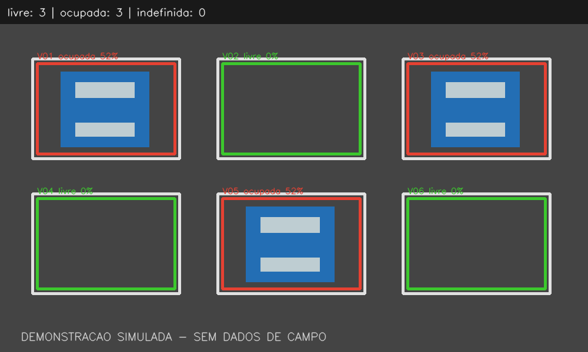

# Monitoramento inteligente de vagas de estacionamento

[](https://github.com/VitorRodi/detector-vagas-estacionamento/actions/workflows/testes.yml)

Projeto acadêmico para a disciplina de Robótica e Visão Computacional, Unochapecó, docente Wagner Titon.

Grupo: Vitor Rodi, Pedro Toigo, Bruno Fell Antunes e Edson Leandro Soares.

## Problema e proposta

O projeto investiga a dificuldade de consultar rapidamente quais vagas de um estacionamento estão disponíveis. A proposta é analisar regiões de uma câmera fixa e apresentar uma indicação visual de ocupação que possa ajudar motoristas e responsáveis pelo local. O estacionamento específico, as observações e as entrevistas ainda precisam ser registrados pelo grupo; não há medição de redução de tempo de procura.

## Situação atual

O protótipo funciona com dados simulados e está preparado para receber imagens e vídeos reais. A coleta e a validação em estacionamento real estão em andamento nas [issues do projeto](https://github.com/VitorRodi/detector-vagas-estacionamento/issues). O vídeo final do grupo ainda não foi gravado ou publicado. A entrega exigida é um link do YouTube acessível e este repositório público.



## Tecnologias e método

Python 3.10 ou mais recente, NumPy e OpenCV. O método utiliza tons de cinza, filtro gaussiano, diferença absoluta contra uma referência vazia, limiarização, abertura morfológica, máscaras poligonais e confirmação temporal. **Não utiliza modelo treinado, rede neural ou pesos externos.**

## O que funciona

- Cadastro manual de vagas como quadriláteros convexos.
- Comparação com uma foto fixa em que **todas as vagas cadastradas estejam vazias**.
- Classificação por fração de pixels alterados, com dois limiares e confirmação temporal.
- Entrada por imagem, vídeo ou câmera local; marcação por cores e contagem de estados.
- Exportação de CSV e imagem ou vídeo anotado.
- Demonstração simulada reproduzível e testes de comportamento.

Este programa mede alterações de aparência. Não reconhece semanticamente carros e pode confundir sombras, pessoas e objetos com ocupação. Não foi validado em estacionamento real.

## Instalar e executar no Windows

Abra o terminal **nesta pasta**, com Python 3.10 ou mais recente:

```powershell
py -m venv .venv
.\.venv\Scripts\python.exe -m pip install -r requirements.txt
.\.venv\Scripts\python.exe demo.py
.\.venv\Scripts\python.exe detector.py --source dados/cena_simulada.png --reference dados/referencia_vazia.png --config dados/vagas_demo.json --output resultados/imagem
.\.venv\Scripts\python.exe detector.py --source dados/video_simulado.mp4 --reference dados/referencia_vazia.png --config dados/vagas_demo.json --output resultados/video
```

Os dados de entrada simulados estão versionados e podem ser regenerados. Os arquivos de saída são criados pelos comandos acima. Abra `resultados/imagem/imagem_anotada.png` ou `resultados/video/video_anotado.mp4` para consultar a saída. Adicione `--show` para exibir uma janela; use Q para sair. Em Linux e macOS, crie o ambiente com `python3 -m venv .venv` e use `.venv/bin/python` nos mesmos comandos.

## Usar imagens reais

1. Siga o [guia de gravação](docs/COLETA_REAL.md), fixe a câmera e mantenha a mesma posição, foco e resolução. Guarde os vídeos locais em `dados/reais/`, que não é publicado automaticamente.
2. Localize no vídeo um quadro com **todas as vagas que serão cadastradas vazias**. Extraia esse quadro na resolução original. Não presuma que o primeiro quadro esteja vazio:

```powershell
.\.venv\Scripts\python.exe extrair_referencia.py --video dados/reais/video_real.mp4 --quadro 0 --output dados/reais/referencia.png --confirmar-vagas-vazias
```

O exemplo usa o quadro zero. Troque o índice se necessário e confirme visualmente a ausência de veículos nas vagas a cadastrar. A opção de confirmação exige essa revisão humana; o programa não verifica automaticamente que a cena está vazia.

3. Cadastre os quatro cantos de cada vaga, em ordem ao redor do contorno:

```powershell
.\.venv\Scripts\python.exe calibrar.py --reference dados/reais/referencia.png --output dados/reais/vagas.json
```

Clique quatro vezes, pressione N para confirmar a vaga, U para desfazer, S para salvar após confirmar todas as vagas ou Esc para cancelar. A janela pode ser redimensionada. Esta interface foi revisada em código; a interação por mouse precisa ser confirmada no computador do grupo.

4. Execute sobre vídeo da **mesma câmera e enquadramento**:

```powershell
.\.venv\Scripts\python.exe detector.py --source dados/reais/video_real.mp4 --reference dados/reais/referencia.png --config dados/reais/vagas.json --output resultados/real --show
```

Para câmera local, use `--source 0`. Câmeras e a interação de calibração dependem de hardware e não foram exercitadas nesta entrega.

## Parâmetros em JSON

`pixel_threshold=25`: diferença mínima em escala de cinza (0 a 255). `occupied_ratio=0.20`: proporção alterada a partir da qual a vaga candidata passa a ocupada. `free_ratio=0.10`: proporção até a qual passa a livre. Entre esses limites, mantém o estado anterior; sem estado anterior fica indefinida. `stable_frames=5`: número de quadros consecutivos para confirmar uma mudança. Em imagem estática a classificação é imediata, sem confirmação temporal.

Estes valores são iniciais. Ajuste-os com um conjunto de calibração e avalie em outro conjunto. Não altere a referência automaticamente: incorporar um carro parado ao fundo pode levar a classificá-lo como vaga livre. O percentual exibido é a fração de pixels alterados, **não uma probabilidade nem confiança de IA**.

CSV: `quadro`, `tempo_video_s`, `vaga`, `estado`, `fracao_alterada`. O tempo é calculado a partir do FPS informado pelo arquivo; em câmera ao vivo é estimado, não representa relógio de captura.

## Verificação

```powershell
.\.venv\Scripts\python.exe -m unittest discover -s tests -v
.\.venv\Scripts\python.exe verificar_demo.py
```

A suíte contém 11 testes de comportamento. Rode `verificar_demo.py` depois de gerar e processar o vídeo simulado. A simulação possui 240 quadros, 6 vagas e 1.440 decisões: 1.408 concordantes com o gabarito, 24 indefinidas na inicialização e 8 divergentes durante a confirmação de transições. A concordância de 97,78% descreve **apenas essa simulação**, não a precisão em campo. O verificador reabre o vídeo anotado, decodifica seus 240 quadros e gera `resultados/verificacao_demo.json`. O GitHub Actions repete esses passos em Windows e Linux.

## Estrutura

```text
detector.py                 Classificação, anotação e exportação
calibrar.py                 Cadastro manual das vagas
demo.py                     Geração do cenário simulado e do gabarito
extrair_referencia.py       Extração de quadro para calibração real
verificar_demo.py           Conferência independente da saída simulada
requirements.txt           Dependências
tests/                     Testes de comportamento
dados/                     Entradas simuladas reproduzíveis
assets/                    Imagem da demonstração
docs/COLETA_REAL.md         Como gravar e registrar imagens reais
docs/ROTEIRO_VIDEO.md       Roteiro com participação dos quatro integrantes
docs/ENTREGA.md             Critérios e conferência dos links finais
.github/workflows/         Execução automática dos testes
```

## Pendências acadêmicas

Definir o estacionamento; concluir a observação/entrevista prevista na etapa 1; obter referência vazia e vídeos autorizados; calibrar e rotular dados reais; medir erros, estados indefinidos, atraso e velocidade; gravar a apresentação com os quatro integrantes e publicar no YouTube como público ou não listado. Não há resultados de campo disponíveis.

O [roteiro de apresentação](docs/ROTEIRO_VIDEO.md) tem duração planejada de 8 minutos e 40 segundos. Os requisitos do professor e o estado de cada entrega estão em [docs/ENTREGA.md](docs/ENTREGA.md).

## Referência técnica

OpenCV, documentação oficial: [operações em matrizes e diferença absoluta](https://docs.opencv.org/4.13.0/d2/de8/group__core__array.html). Acesso em 13/11/2026.
