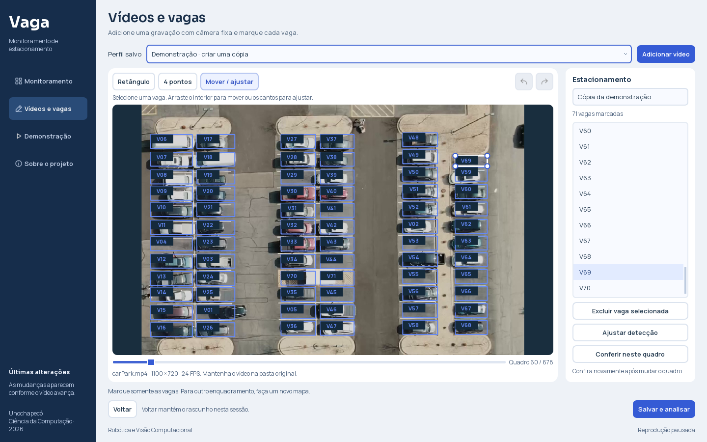

# Cadastrar outro estacionamento

O editor funciona no painel principal do aplicativo, em **Vídeos e vagas**. Não abre outra janela de edição. O seletor de arquivos do sistema é usado para escolher a gravação. O vídeo precisa ter câmera fixa, FPS e duração legíveis; MP4 e AVI são as opções mais comuns, conforme os codecs disponíveis no OpenCV.

## Primeiro cadastro

1. Abra **Vídeos e vagas → Adicionar vídeo** e escolha uma gravação local.
2. Dê um nome ao estacionamento. O arquivo de vídeo permanece na pasta original: mantenha-o nesse local.
3. Use a barra abaixo da imagem para escolher um quadro em que as divisões das vagas estejam visíveis. Não precisa estar vazio no modo por textura.
4. Em **Retângulo**, clique e arraste para marcar uma vaga. Para vagas em perspectiva, use **4 pontos** e clique nos cantos em sequência, contornando a vaga sem cruzar as linhas.
5. Repita para as vagas que deseja acompanhar. Corredores, árvores e ilhas devem ficar fora das marcações.
6. Clique em **Conferir neste quadro** e compare as cores com a imagem. Repita em vários instantes, incluindo vagas vazias e ocupadas.
7. Clique em **Salvar e analisar**. O aplicativo salva o perfil, retorna ao monitoramento e processa o vídeo escolhido. Os contadores ficam indisponíveis até a análise completa terminar.

As vagas não são encontradas automaticamente: o usuário cadastra a geometria. A técnica mede textura, sem rede neural ou reconhecimento semântico de automóveis. Um novo local pode exigir outros limiares e pode continuar apresentando erros por sombras, pessoas, oclusões e superfícies lisas. O mapa só vale enquanto o enquadramento permanecer igual.

## Corrigir marcações

Em **Mover / ajustar**, clique em uma vaga ou selecione-a na lista. Arraste seu interior para mover o polígono; arraste os círculos dos cantos para ajustar sua forma. O editor mantém as coordenadas na resolução do vídeo mesmo quando a janela muda de tamanho. Cantos não podem produzir polígonos cruzados ou sair da imagem.

**Excluir vaga selecionada** remove a região do rascunho. **Desfazer** e **Refazer** recuperam alterações. Com o desenho em foco, Ctrl+Z desfaz, Ctrl+Y refaz, Delete/Backspace exclui e Esc cancela o gesto atual. Excluir uma vaga não renumera as outras.

**Voltar**, Monitoramento e Sobre o projeto mudam a página na mesma janela e mantêm o rascunho durante a sessão. O rascunho não sobrevive ao fechamento do aplicativo: salve para persistir. Trocar para outro perfil ou outro vídeo solicita descartar alterações não salvas.

## Conferir e ajustar a detecção

O desenho fica azul durante o cadastro. **Conferir neste quadro** mostra verde, vermelho e amarelo conforme a classificação pontual. Essa conferência não aplica os cinco quadros de confirmação temporal usados na análise completa e não mede precisão. Alterar a geometria, os limiares ou o quadro remove essa prévia.

Em **Ajustar detecção**, os limiares gerais indicam a porcentagem de textura para livre e ocupada; livre deve ser menor que ocupada. No novo perfil, os valores iniciais são 11% e 12%, margem interna de um pixel e cinco quadros de confirmação. São pontos de partida, não uma calibração universal.

Uma cópia da demonstração mantém os ajustes locais de V06/V18, a margem de três pixels e a regra conjunta de V70/V71. Excluir um membro remove o grupo de revisão correspondente do mapa salvo. O editor não cadastra novos grupos de ocupação ambígua; esse recurso continua restrito aos grupos presentes na configuração copiada.

## Reabrir, salvar e exportar

Escolha o estacionamento em **Perfil salvo**. Sem edições, **Abrir análise** reutiliza resultados completos compatíveis; se não existirem, inicia o processamento. Depois de editar, **Salvar e analisar** cria outra revisão com uma pasta de resultados independente. A revisão anterior permanece no disco, mas não há uma interface para restaurá-la automaticamente.

Os perfis ficam em `perfis/<id>/perfil.json`, com revisões em `revisoes/<id>/`. Cada revisão guarda `mapa.json`, `referencia.png` e sua pasta `resultados/`. O vídeo é referenciado pelo caminho local, sem cópia, envio ou publicação. `perfis/` é ignorada pelo Git. Para levar a outra máquina, leve também a gravação e cadastre-a no novo local; mover ou substituir o arquivo exige novo cadastro para conferir as marcações.

O programa verifica tamanho e data de alteração da gravação e o hash do mapa antes de reutilizar os resultados. A análise precisa terminar com a quantidade de quadros informada pelo vídeo; arquivos incompletos ou com metadados incompatíveis devem ser corrigidos ou convertidos antes de usar.

**Exportar resultados** inclui os relatórios disponíveis, o vídeo anotado, `mapa.json` e `referencia.png` de perfis locais. Vídeos novos não herdam `avaliacao.json`, os rótulos ou a precisão da demonstração. A página Sobre informa **Sem avaliação rotulada** até que haja um conjunto próprio conferido fora desse fluxo.

O botão **Demonstração** retorna ao exemplo distribuído no projeto. Escolher **Demonstração · criar uma cópia** no editor permite experimentar o mapa incluído sem alterar seus arquivos originais.
